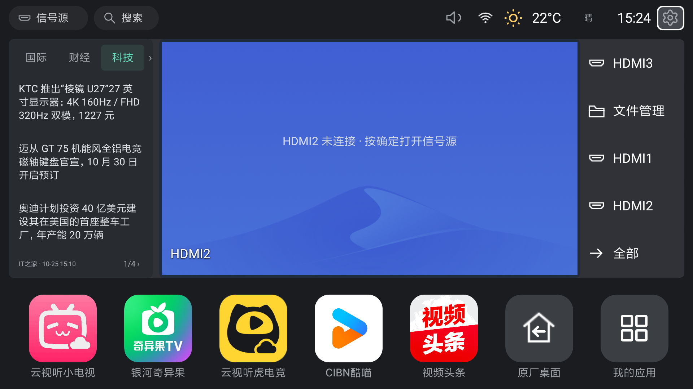
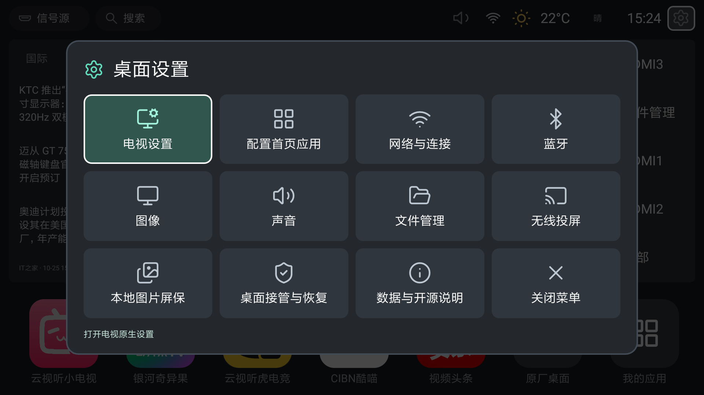

# 简净桌面 · MiQuiet Launcher

**简体中文** | [English](README.en.md)

面向**小米电视 / 小米TV（Xiaomi TV / Mi TV）**的轻量开源桌面。保留常用应用、信号源入口和电视设置，配上天气、新闻与本地图片屏保，让首页回到日常需要的内容。

原生Java编写，MIT开源。通过ADB安装，在已适配固件上使用无障碍服务接管Home；保留原厂桌面，支持返回和撤销接管。无需Root，不修改或覆盖小米原厂APK。这是社区项目，与小米官方无关联。

给其他agent的开发入口：[AGENTS.md](AGENTS.md)；为类似小米电视安装、接管和恢复：[完整部署指南](docs/agent-deployment.md)。新型号需先核对固件适配，不能视为通用替换所有电视的系统桌面。

当前版本为 **0.8.0**，已在MiTV4-ANSM0（Android 6.0.1 / API 23）实测。设置采用带图标和文字的4列×3排矩阵，支持遥控器上下左右直达；顶部改用标准圆角齿轮。首页保留信号源区域、可配置应用栏和常用设置。设置与截图验收见[0.8.0记录](docs/settings-grid-080.md)，此前新闻换源见[0.7.2记录](docs/news-sources-072.md)，完整屏保等功能验收见[0.7.1记录](docs/acceptance-20261025.md)。

## 界面预览

首页：



设置菜单（4列×3排）：



以上为0.8.0在电视上的实机截图。应用、新闻和天气随配置及时间变化；截图中的HDMI未连接，不代表正在显示视频信号。截图来源与版权边界见[图片说明](docs/images/README.md)。

## 使用

- 遥控器方向键移动，确定打开；预览区域确定进入原厂全屏信号源。
- 遥控器菜单键或右上角圆角齿轮打开设置矩阵；方向键按行列移动，确定打开，返回／菜单键或“关闭菜单”退出。电视设置在首项，关闭后焦点回到顶部设置按钮。
- “配置首页应用”：勾选要显示的应用并保存。“我的应用”始终保留。
- 长按首页应用可左移、右移或从首页移除。移除首页入口不卸载应用。
- 搜索覆盖本机已安装应用。
- 底部“原厂桌面”快捷按钮暂停接管并打开原厂；显式重开简净桌面后恢复此前开启的接管。按钮位于常用应用和“我的应用”之间。
- 天气栏显示摄氏度、简短描述和天气图标，不显示城市。点击／确定直接打开小米天气；长按显示“选择天气位置”“使用网络自动定位”“立即刷新”三个选项。
- 左侧新闻有国内、国际、财经、科技、游戏、AI 六个固定标签，一次显示约三个；左右方向键移动标签焦点，鼠标可在标签栏滚轮横向查看。点击／确定切换并尝试刷新该分类，无须长按。标题打开摘要，底部翻页，长按页码也可刷新当前分类。每栏最多 12 条。
- 摘要中的阅读按钮使用电视系统 WebView，进入适合电视的正文阅读模式，无需浏览器。订阅源提供足够内容时直接排版，财经与AIHOT也直接使用原站快讯／聚合摘要，标明可能为节选；游戏和其他短摘要尝试获取原站正文。正文由原生 HTTPS 客户端获取，WebView 全程关闭脚本。方向键滚动，上方按钮调整字号，返回键退出。WebView 不可用或文章在本次进程中已确认不可解析时隐藏入口；网络加载失败可在阅读页重试。
- 天气约每 15 分钟、当前分类新闻约每 10 分钟刷新；更新失败标记缓存，天气超过 6 小时、新闻超过 48 小时停止显示。位置可因运营商出口或代理而偏移，能在天气设置中手动更改。

## Home 接管

这台固件未提供标准无障碍设置页，“帐号与安全”中也没有该入口。首次启用或恢复接管，在电脑运行：

```powershell
python tools/enable_home.py --serial TV_SERIAL --expected-model MODEL
```

工具先保存现有授权，再通过应用自己的系统受限入口启用服务，向系统服务名单追加本项目，并检查实际绑定及其他原有服务是否仍在。它同时仅为本项目开启 GET_USAGE_STATS，用于弥补原厂主页缺失的窗口事件。应用没有 WRITE_SECURE_SETTINGS 权限。

服务监听原厂主桌面的窗口事件，并在独立线程每 400ms 检查最近 3 秒的应用前台/后台事件。内存中只保留当前包名和页面类名，仅在确认原厂主页且接管未暂停时打开新桌面；不读取屏幕文字，不保存应用使用历史。返回原厂、暂停或服务解绑后，最终切换决定会在主线程再次检查状态。另有开机广播恢复路径。是否已通过实际重启验收，以 docs/verification.md 为准。

## 本地图片屏保

遥控器菜单键 → 向下找到“本地图片屏保”。默认静置 12 分钟启动，每 30 秒切换；可调整等待时间、图片间隔，或关闭本地屏保。只在新桌面有焦点且前台时计时，打开应用、HDMI、对话框或设置时取消，按任意键退出屏保。电源键仍交给系统。

“图片管理与导入”统一显示缩略图和勾选状态，支持批量选择、放大查看、导入进度与批量移除。“添加图片”可进入电视相册、下载、图片文件夹、内部存储或可读取的 U 盘；按返回键逐级回退。这里使用应用内选择界面，不依赖系统图片选择器。支持 JPG、PNG、WebP、BMP，最多 24 张、单张最多 32MB。图片导入本应用私有目录，拔掉 U 盘后仍可播放；移除的只是屏保副本。未选图片时使用三幅本地绘制的风景和移动时钟，屏保没有联网代码。

也可点击“电脑 / 手机传图”，在同一局域网的浏览器打开电视显示的地址，输入六位连接码，选择多张图片保存。临时上传接收器仅在传图窗口打开且页面前台时运行，关闭窗口或切到其他应用即停止；不提供查看或下载照片的接口。传图内容通过本地 HTTP 发送。电脑浏览器到电视的 PNG／JPEG／WebP 上传、错误反馈、24张上限、关闭和切应用时停止接收，以及遥控器跨目录选图、媒体库导入、预览、移除和实际轮播均已通过。真实 U 盘未插入，USB 插拔仍未验收。

这台固件的原厂广告屏保由 `screen_saver_timeout` 独立触发，标准 Android 的 `screensaver_enabled` 原本已关闭。已备份后将原厂定时器设置为 `-2`，并核对实际读回；未禁用或卸载原厂相册包。

```powershell
python -B tools/screensaver_tv.py status --serial TV_SERIAL --expected-model MODEL
python -B tools/screensaver_tv.py disable --serial TV_SERIAL --expected-model MODEL --backup nor/backups/DEVICE/screensaver.json
# 恢复备份中的原厂 12 分钟屏保设置（会恢复原厂广告屏保）
python -B tools/screensaver_tv.py restore --serial TV_SERIAL --expected-model MODEL --backup nor/backups/DEVICE/screensaver.json
```

备份在 `nor/backups/screensaver-20261024/`，包括原设置和两个原厂 APK。恢复原厂桌面的工具与恢复原厂屏保是两个独立操作；在原厂设置重新选择屏保等待时间也可能覆盖关闭值。详见 [屏保验收](docs/screensaver-20261024.md)。

## 安装与构建

已验证JDK11、SDK32、Build Tools32.0.0；电脑端工具需要Python3.11以上。用环境变量`QUIET_TV_JDK`／`JAVA_HOME`指定JDK、`ANDROID_HOME`指定SDK；也会尝试PATH中的javac与标准Android Studio目录。具体准备与设备检查见[部署指南](docs/agent-deployment.md)。`TV_SERIAL`和`MODEL`均为需要替换的占位符。

```powershell
python -B tools/build.py --test
python -B -m unittest discover -s tests -p 'test_*.py' -v
python -B tools/build.py
adb -s TV_SERIAL install -r nor/dist/quiet-tv.apk
adb -s TV_SERIAL shell am start -W -n local.mitv.launcher/.MainActivity
```

构建脚本直接使用现有 SDK，不依赖 Gradle 下载。APK 在 `nor/dist/quiet-tv.apk`，本机开发签名密钥在 `nor/.local/launcher.keystore`；保留该密钥才能无卸载更新。可设置环境变量 `ANDROID_HOME`、`QUIET_TV_JDK` 改变路径。

应用包名仍为`local.mitv.launcher`，APK文件名保持`quiet-tv.apk`，公开项目名称不影响现有安装和签名。新克隆会生成自己的开发密钥；更新必须使用与已安装版本相同的签名，不要通过卸载来掩盖签名冲突，以免丢失配置和屏保照片。

也提供 Android Studio Gradle 工程配置（AGP 7.4.2，需 Gradle 7.5 或兼容版本）；先用上述脚本生成本机签名密钥。Gradle 导入路径未代替已验证的直接构建流程。

## 恢复

正常回原厂：底部“原厂桌面”按钮。电脑端恢复：

```powershell
powershell -NoProfile -ExecutionPolicy Bypass -File tools/restore_tv.ps1 -Serial TV_SERIAL -ExpectedModel MODEL
```

本固件不允许 shell 用 `pm disable-user` 修改应用状态；脚本调用自建桌面的恢复入口，由应用禁用自己的 Home 服务并返回原厂，只有具备系统 DUMP 权限的调用方（ADB shell）可触发该入口。随后只从服务名单移除本项目，并撤销本项目的前台应用检测授权，保留其他服务和其他应用的权限。不会卸载或修改原厂包。

再次打开新桌面：

```powershell
powershell -NoProfile -ExecutionPolicy Bypass -File tools/restore_tv.ps1 -Serial TV_SERIAL -ExpectedModel MODEL -EnableNewLauncher
```

该命令只打开桌面。若要重新启用Home接管，运行`python tools/enable_home.py --serial TV_SERIAL --expected-model MODEL`。设备重启可能关闭网络ADB，需在电视设置中重新开启。

## 备份与边界

`nor/backups/2026-10-22/manifest.json` 记录 20 个 APK（约 308.7 MiB），包括当前原厂桌面和出厂版、设置、信号源、系统 UI、媒体管理、投屏及五个常用应用。每个文件已核对远端/本地 SHA-256、字节数和 ZIP CRC。备份还有包状态、系统设置和截图；这不是整机镜像，不包含完整应用私有数据。

原厂桌面和系统包均保留。HDMI 真实视频依赖外部设备提供信号；没有信号时显示明确状态和原厂蓝色背景。当前固件只注册了 HDMI3 的 TvInputInfo，HDMI1/2 走与原厂一致的播放器入口，但系统缺失输入时无法保证完成切换；具体实测记录见 docs/verification.md。

2026-10-24 的 0.3.2 通过了同一 APK 连续两次完整重启：自动进入新桌面、服务和授权均保留。0.7.1 沿用同一接管实现，本轮连续 Home 为 3.67／3.61／2.89 秒，三项服务和授权保留；未重复完整重启。严格 3 秒性能检查仍有偶发超限，外部应用退出时可能更慢，不承诺所有场景 3 秒内。完整接管记录见 docs/verification.md。

取证文档在 nor/research/，涉及本机状态和原厂反汇编，不应整目录公开上传。

## 本地资料

Git 记录源码、工具、测试和文档；`nor/` 保存不提交的构建产物、原厂 APK 备份、签名密钥和取证资料。历史取证记录中的旧根目录路径均对应 `nor/` 下的同名目录。请单独备份 `nor/.local/launcher.keystore` 与原厂 APK；Git 不含这些文件。

公开源码与Git历史已清理原设备地址和电脑路径，维护者选择保留提交作者姓名及邮箱。每次发布前运行`python -B tools/audit_public.py --history`并人工复核，见[发布前检查](docs/publishing.md)。不要发布`nor/`中的清理前历史恢复副本。

## 新闻来源可以自己调整

**当前新闻类别、来源及游戏过滤规则，是按作者个人阅读偏好选择的默认配置。你可以按自己的兴趣调整，并不需要沿用这套来源。**

| 类别 | 当前来源 |
| --- | --- |
| 国内、国际 | 央视网 |
| 财经 | 华尔街见闻快讯 |
| 科技 | IT之家RSS |
| 游戏 | 游民星空单机资讯，按标题／摘要关键词过滤部分与PC游戏无关的内容 |
| AI | [AIHOT RSS](https://aihot.news/feed.xml) |

目前更换新闻源需要修改源码，**还没有电视端任意添加RSS的设置界面**。主要修改位置：

- [NewsSources.java](app/src/main/java/local/mitv/launcher/NewsSources.java)：分类、来源名称、请求地址和文章域名。
- [DashboardRepository.java](app/src/main/java/local/mitv/launcher/DashboardRepository.java)：响应解析、摘要、缓存和阅读内容；不同接口格式需要对应解析，不能只替换URL。
- [GameNews.java](app/src/main/java/local/mitv/launcher/GameNews.java)：游戏列表解析与关键词过滤，可按喜好修改或取消过滤。
- [ArticleHtml.java](app/src/main/java/local/mitv/launcher/ArticleHtml.java)、[LegacyTls.java](app/src/main/java/local/mitv/launcher/LegacyTls.java)：必要时适配原站正文与固定主机的旧系统TLS兼容，保留证书和主机名校验。

修改后重建安装，并按需运行`tools/check_dashboard.py --serial TV_SERIAL --expected-model MODEL --news`。当前UI使用六个固定分类，改变分类数量时也要检查标签、数据与布局逻辑。

## 数据源与开源复用

实际复用 MIT 许可的 Tabler Icons 天气图标，已保留原始 SVG、许可、版本及转换脚本。天气用 Open-Meteo API，位置搜索用 Open-Meteo / GeoNames；国内／国际新闻读取央视网页面数据；财经使用华尔街见闻快讯，科技用IT之家RSS，游戏直连游民星空单机列表、筛选PC相关内容，AI使用用户指定的AIHOT RSS。分类聚合与订阅阅读交互参考 NewsNow、Read You，未打包其应用代码。新闻内容不属于开源代码。详见 [第三方说明](THIRD_PARTY_NOTICES.md)。

实机数据和 TLS 校验测试（先构建 APK，电视需开启 ADB）：

```powershell
python -B tools/check_dashboard.py --serial TV_SERIAL --expected-model MODEL
python -B tools/check_dashboard.py --serial TV_SERIAL --expected-model MODEL --news
python -B tools/check_home.py --serial TV_SERIAL --max-seconds 8
```

Android 6 缺少较新的天气服务根证书，应用仅对固定天气／新闻数据服务补充公开 CA；保留系统链校验、主机名校验和 HTTPS。实机测试同时检查正常连接和三类无效证书拒绝。测试只运行临时 shell 程序，不安装测试应用。

电脑端数据源调研（不会连接电视）：

```powershell
python -B tools/research_news.py
```

直接构建会依据 SDK API 历史检查平台方法引用，阻止误用 API 24 以上接口；这不能替代 Android 6 实机验证。

项目源码采用[MIT许可证](LICENSE)。GitHub仓库名称、中文简介和Topics可参考[仓库元信息](docs/github-about.md)；默认文档面向中国大陆地区用户和开发者，英文说明见[English README](README.en.md)。
